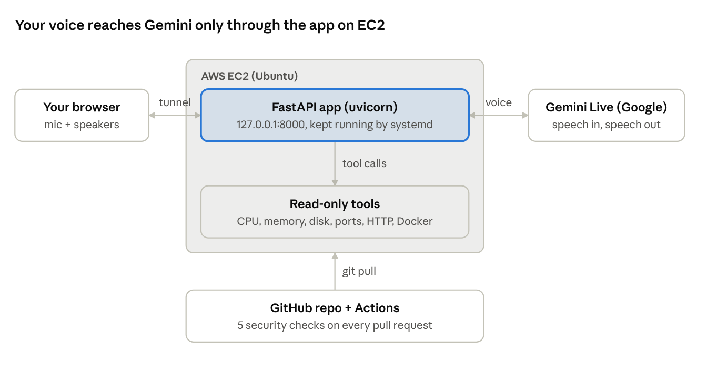
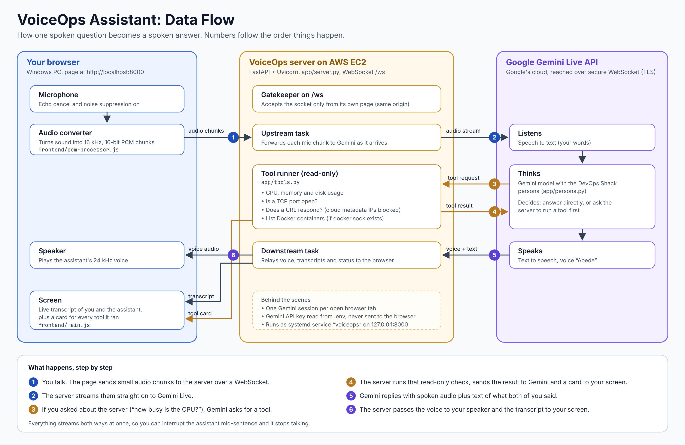
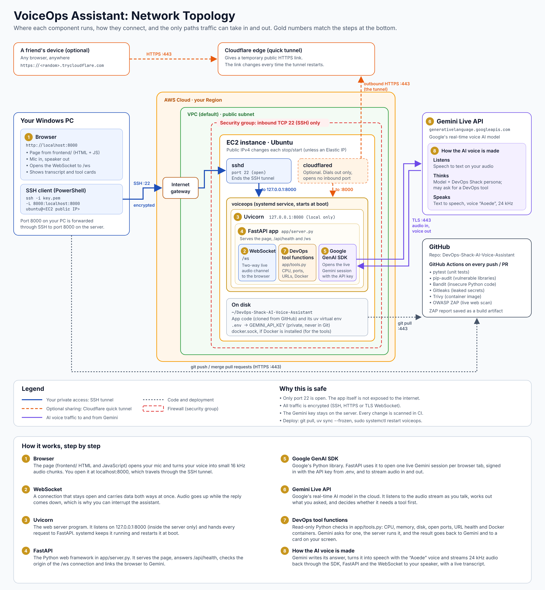
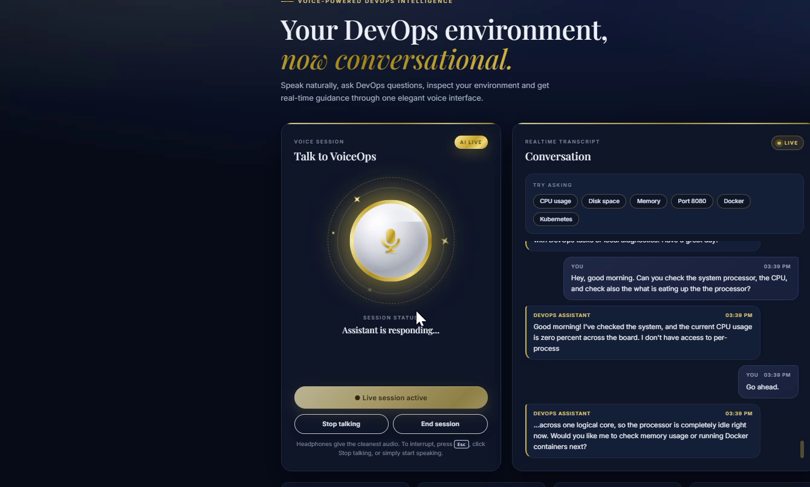
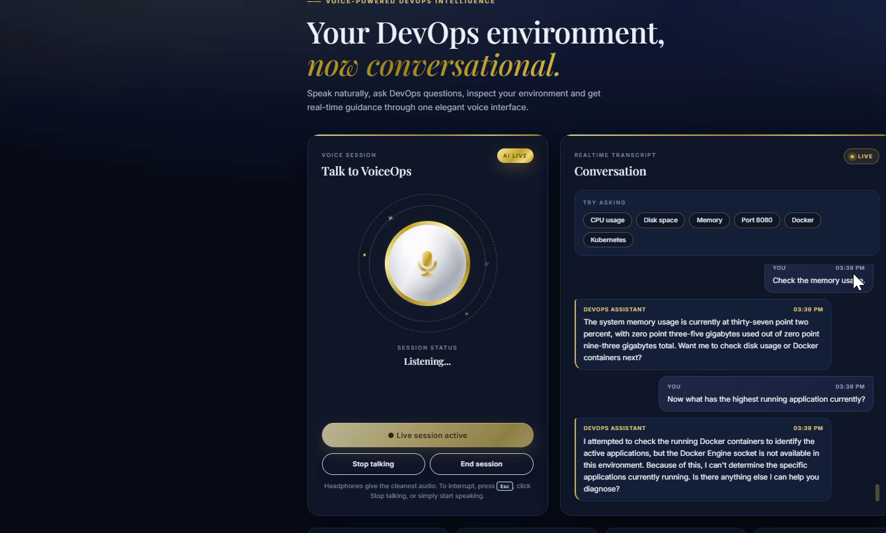

# VoiceOps AI Voice Assistant on AWS: Start-to-Finish Guide

A beginner's guide to building this project from nothing: a voice assistant you talk to in your browser, running on AWS EC2, scanned for security problems on every change, and shareable without exposing the server's IP address.

**Watch the finished app:** [demo recording (1 min 45 s, MP4)](guide/voiceops-demo.mp4) · full transcript in [Program output](#program-output)

## Contents

- [Overview](#overview)
- [Part 1: Get a Gemini API key](#part-1-get-a-gemini-api-key)
- [Part 2: Launch the EC2 server](#part-2-launch-the-ec2-server)
- [Part 3: Connect to the server with SSH](#part-3-connect-to-the-server-with-ssh)
- [Part 4: Get the code and install it](#part-4-get-the-code-and-install-it)
- [Part 5: Keep the app running on its own (systemd)](#part-5-keep-the-app-running-on-its-own-systemd)
- [Part 6: Open it in your browser (SSH tunnel)](#part-6-open-it-in-your-browser-ssh-tunnel)
- [Part 7: Share it with a friend (Cloudflare quick tunnel)](#part-7-share-it-with-a-friend-cloudflare-quick-tunnel)
- [Part 8: Add the security pipeline (CI/CD)](#part-8-add-the-security-pipeline-cicd)
- [Part 9: Stop controls and the new design](#part-9-stop-controls-and-the-new-design)
- [Part 10: Ship a change and update the server](#part-10-ship-a-change-and-update-the-server)
- [Program output](#program-output)
- [Troubleshooting](#troubleshooting)
- [Cleanup, costs and next steps](#cleanup-costs-and-next-steps)

## Overview

This project is a fork of the open-source DevOps Shack AI Voice Assistant, deployed by following the DevOps Shack [YouTube tutorial](https://www.youtube.com/watch?v=-HPs8iHdCVA). It was then hardened with a CI/CD security pipeline, given stop controls, and redesigned.

**How it works, in one sentence:** your browser sends your voice to a small Python web app (FastAPI) on EC2, the app streams it to Google's Gemini Live model, and Gemini's spoken answer streams back to your speakers. When you ask about CPU, memory, disk, ports or Docker, Gemini asks the app to run a read-only check and speaks the result.



The tunnel is either your private SSH tunnel (Part 6) or a public Cloudflare link (Part 7). The app itself is never exposed to the internet.

### Data flow: how one question becomes a spoken answer

Six numbered steps, from your microphone through the server and Gemini back to your speaker. Steps 3 and 4 only happen when you ask about the server and Gemini calls a tool.



### Network topology: where everything runs

The EC2 instance sits in a VPC behind a security group that opens only SSH port 22. You reach the app through the SSH tunnel, a friend through the optional Cloudflare tunnel, and the server talks out to Gemini over TLS port 443. The panel at the bottom explains each numbered part in plain words.



### What you need before you start

| Item | Why | Cost |
| --- | --- | --- |
| AWS account | Runs the server | Free tier covers a t2.micro / t3.micro for 12 months |
| Google account | For the Gemini API key | Free tier |
| GitHub account | Holds your copy of the code and runs the security checks | Free |
| A Windows PC with VS Code (or PowerShell) | To connect to the server | Free |
| MobaXterm (optional) | A friendlier SSH window for Windows | Free edition |
| Headphones with a mic | Stops the assistant hearing itself | Already owned |

## Part 1: Get a Gemini API key

The key is the password the app uses to talk to Gemini. It is free and takes two minutes.

1. Go to [aistudio.google.com/apikey](https://aistudio.google.com/apikey) and sign in with your Google account.
2. Click **Create API key** and choose (or create) a project.
3. Copy the key and keep it somewhere private, like a password manager. Keys can start with `AIza` or `AQ.`; both work.

**Keep it secret.** Never paste it into a screenshot, a chat, or a file you push to GitHub. If it leaks, delete it in AI Studio and create a new one.

## Part 2: Launch the EC2 server

You are renting a small Linux computer in Amazon's data centre.

1. Sign in to the [AWS console](https://console.aws.amazon.com/), search **EC2**, and click **Launch instance**.
2. **Name:** `voiceops`.
3. **Image (AMI):** Ubuntu Server 24.04 LTS (free tier eligible).
4. **Instance type:** `t2.micro` or `t3.micro` (free tier).
5. **Key pair:** click **Create new key pair**, name it (for example `firstmachine`), type RSA, format `.pem`. It downloads to your Downloads folder. Don't lose it: it is the only way in.
6. **Network settings:** tick **Allow SSH traffic from** and pick **My IP**. Leave HTTP/HTTPS unticked; the app is never opened to the internet directly.
7. **Storage:** 8 GB is enough (16 GB if you plan to try Docker).
8. Click **Launch instance**, then **View all instances**. Wait until **Instance state** is Running and **Status checks** shows 2/2 passed.
9. Click the instance and copy its **Public IPv4 address**. You will use it in every SSH command.

**The IP changes every time you stop and start the instance.** Always copy the current one from the console. For a fixed address, attach an **Elastic IP** (free while the instance runs, a small hourly charge while it is stopped).

Security group rules:

| Type | Port | Source | Needed? |
| --- | --- | --- | --- |
| SSH | 22 | My IP | Yes |
| Custom TCP | 3000-9000 | 0.0.0.0/0 | No, delete it: the tunnel and Cloudflare don't need it |

## Part 3: Connect to the server with SSH

SSH gives you a terminal on the server. Pick either option; both use the same key.

**Option A: VS Code or PowerShell (built into Windows)**

1. In VS Code: **Terminal → New Terminal**. The prompt should read `PS C:\Users\<you>>`.
2. Go to the folder with your key and connect (replace the IP with yours):

```
cd C:\Users\<you>\Downloads
ssh -i .\firstmachine.pem ubuntu@<PUBLIC-IP>
```

3. Type `yes` the first time. The prompt changes to `ubuntu@ip-...:~$`. You are now **on the server**.

**Option B: MobaXterm**

1. **Session → SSH**. Remote host: your public IP. Tick **Specify username**: `ubuntu`.
2. **Advanced SSH settings → Use private key** → pick your `.pem` file → **OK**.

**Know which machine you are on.** `PS C:\...` = your PC. `ubuntu@ip-...` = the server. Most mistakes in this project come from running a command on the wrong one.

## Part 4: Get the code and install it

**4a. Fork the repo (on github.com).** Open this project on GitHub and click **Fork**. You now have your own copy at `github.com/<your-username>/DevOps-Shack-AI-Voice-Assistant`, which you can change freely.

**4b. Install the tools (on the server).** `git` downloads code; `uv` is a fast Python installer that also fetches the right Python version (3.11) by itself.

```
sudo apt update && sudo apt install -y git curl
curl -LsSf https://astral.sh/uv/install.sh | sh
echo 'export PATH="$HOME/.local/bin:$PATH"' >> ~/.bashrc
source ~/.bashrc
uv --version
```

The `echo ... >> ~/.bashrc` line makes `uv` available in every future login, not just this one. If `uv --version` prints a version number, it worked.

**4c. Clone your fork and add your key (on the server).**

```
cd ~
git clone https://github.com/<your-username>/DevOps-Shack-AI-Voice-Assistant.git
cd DevOps-Shack-AI-Voice-Assistant
cp .env.example .env
nano .env
```

In nano, replace `replace_with_your_google_api_key` with your real key. Save with **Ctrl+O, Enter**, exit with **Ctrl+X**. The `.env` file is listed in `.gitignore`, so it is never uploaded to GitHub.

**4d. Install the libraries and test-run it.**

```
uv sync --frozen
uv run uvicorn app.server:app --host 127.0.0.1 --port 8000
```

When you see `Uvicorn running on http://127.0.0.1:8000`, it works. Press **Ctrl+C** to stop it; the next part makes it run on its own.

*Prefer pip?* `python3 -m venv .venv && source .venv/bin/activate && pip install -r requirements.txt` does the same job. This guide uses uv because it's faster and installs exactly the versions in `uv.lock`.

## Part 5: Keep the app running on its own (systemd)

A systemd service starts the app at boot, restarts it if it crashes, and keeps it running after you close SSH.

**5a. Create the service file (on the server).** Paste this whole block at once:

```
sudo tee /etc/systemd/system/voiceops.service > /dev/null <<'EOF'
[Unit]
Description=DevOps Shack VoiceOps Assistant
After=network-online.target

[Service]
User=ubuntu
WorkingDirectory=/home/ubuntu/DevOps-Shack-AI-Voice-Assistant
ExecStart=/home/ubuntu/.local/bin/uv run uvicorn app.server:app --host 127.0.0.1 --port 8000
Restart=always

[Install]
WantedBy=multi-user.target
EOF
```

**5b. Turn it on.**

```
sudo systemctl daemon-reload
sudo systemctl enable --now voiceops
sudo systemctl status voiceops
```

You want to see **active (running)** in green. Press **q** to leave the status screen.

**Why 127.0.0.1?** It means the app only listens inside the server, so nobody on the internet can reach it directly. You will reach it through an SSH tunnel (Part 6) or Cloudflare (Part 7).

| Task | Command |
| --- | --- |
| Watch live logs | `journalctl -u voiceops -f` |
| Restart (after changing `.env` or pulling new code) | `sudo systemctl restart voiceops` |
| Quick health check | `curl http://127.0.0.1:8000/api/health` |
| Stop and disable | `sudo systemctl disable --now voiceops` |

Right after a restart, give it about 5 seconds before you check its health.

## Part 6: Open it in your browser (SSH tunnel)

An SSH tunnel makes the server's port 8000 appear on your PC as `localhost:8000`, so your browser can reach the app privately.

1. **On your PC** (not the server), open a new VS Code terminal or PowerShell. The prompt must start with `PS C:\`.
2. Run, with the current public IP:

```
cd C:\Users\<you>\Downloads
ssh -i .\firstmachine.pem -L 8000:localhost:8000 ubuntu@<PUBLIC-IP>
```

3. Leave that window open. Closing it closes the tunnel.
4. Open **http://localhost:8000** in Chrome or Edge.
5. Click **Start live session** (or the mic itself) and allow microphone access when the browser asks.
6. Speak. The transcript appears on the right and tool checks appear under **Tool activity**.

The browser only allows the microphone on `localhost` or `https://` pages. That is why you use the tunnel instead of typing the server's IP into the browser.

**MobaXterm alternative:** **Tunneling → New SSH tunnel** → Local port forwarding, forwarded port `8000`, remote server `localhost` port `8000`, SSH server = your public IP, user `ubuntu`, then add your key and click start.

## Part 7: Share it with a friend (Cloudflare quick tunnel)

A Cloudflare quick tunnel gives you a public `https://` link without opening any port or revealing the server's IP. No Cloudflare account is needed.

**7a. Install cloudflared (on the server, once).**

```
curl -L -o cloudflared.deb https://github.com/cloudflare/cloudflared/releases/latest/download/cloudflared-linux-amd64.deb
sudo dpkg -i cloudflared.deb
```

**7b. Start the tunnel.**

```
cloudflared tunnel --url http://localhost:8000
```

Look for a line like `https://some-random-words.trycloudflare.com` and send that link to your friend. It works on any device, and the microphone works because it is `https://`.

Things to know:

- The link lives only while that command runs. Close the window or reboot the server and it stops; the next run gives a new link.
- Anyone with the link can talk to the assistant on **your** Gemini key. Share it only with people you trust, and stop the tunnel (Ctrl+C) when you're done.
- For a permanent link that survives reboots, use a **named tunnel** run as a service. It needs a free Cloudflare account and your own domain name.

## Part 8: Add the security pipeline (CI/CD)

Every time code is pushed or a pull request is opened, GitHub Actions runs 5 checks. A change is merged only when all 5 are green. The pipeline lives in one file, [`.github/workflows/security.yml`](../.github/workflows/security.yml), and if you forked this repo you already have it.

| Check | Tool | What it catches |
| --- | --- | --- |
| Unit tests | pytest (13 tests) | Broken features, and regressions of the security fixes below |
| Vulnerable libraries | pip-audit | Python packages with known CVEs |
| Insecure code | Bandit | Risky Python patterns (shell injection, unsafe URL opening) |
| Leaked secrets | Gitleaks | API keys or passwords committed anywhere in git history |
| Container + live app | Trivy, then OWASP ZAP | Vulnerable OS packages in the Docker image, Dockerfile mistakes, and web weaknesses in the running app |

**To turn it on in your fork:**

1. On your fork, open the **Actions** tab. Forks start with Actions off: click **I understand my workflows, go ahead and enable them**.
2. Make any small change (for example, edit `README.md` on github.com) and commit it to a new branch, then open a pull request.
3. Watch the checks at the bottom of the pull request. Click **Details** on any check to see its log. The ZAP report can be downloaded from the run's **Artifacts** section.

**What the first scans found, and the fixes now in the code:**

| Finding | Risk | Fix (file) |
| --- | --- | --- |
| The HTTP and port tools could be pointed at 169.254.169.254, the EC2 metadata address that hands out AWS credentials (SSRF) | Critical | Block link-local, multicast and unspecified addresses, and never follow redirects (`app/tools.py`) |
| CORS allowed every website, and the WebSocket accepted any origin | High | Removed CORS; `/ws` refuses foreign origins with code 1008 (`app/server.py`) |
| Outdated libraries with CVEs (cryptography, urllib3, certifi, anyio, pyasn1) | High | Upgraded in `uv.lock`, and 25 unused packages removed (62 down to 37) |
| Old zlib and setuptools 70.3.0 (CVE-2025-47273) in the Docker image | High | `apt-get upgrade`, and pip/setuptools/wheel removed from the runtime image (`Dockerfile`) |
| Container ran as root | Medium | Runs as `appuser` (uid 10001), with a health check (`Dockerfile`) |
| Errors silently swallowed (`except: pass`) | Low | Logged instead (`app/server.py`) |

Still open by design: the app has no login, so share the Cloudflare link carefully. ZAP also reports 9 warnings, mostly missing security headers; adding them is a good next exercise.

## Part 9: Stop controls and the new design

The original assistant kept talking after you wanted it to stop, and its page was plain. Both are fixed in the code you forked.

**Stop controls**

| Control | What it does |
| --- | --- |
| **Stop talking** button or the **Esc** key | Cuts the voice at once and throws away the rest of that answer |
| Start speaking over it | Same as Stop talking (barge-in) |
| Say "stop" or "that's enough" | The assistant is instructed to stop immediately |
| **End session** button | Closes the connection and turns off your mic |

Answers are also kept to 2 or 3 sentences by default, with an offer to go deeper. The changes are in `frontend/main.js` (buttons, Esc key, dropping late audio), `frontend/index.html` (the buttons), `app/server.py` (tells the browser when Gemini finishes a turn) and `app/persona.py` (shorter answers, stop on request).

**The design**

- Blue-black background with serif headings.
- The mic is a polished silver sphere in a gold ring, with twinkling yellow sparkles. It glows while listening and pulses while speaking. Click it to start a session.
- Gold for the main button, chips, icons and the assistant's replies; silver for secondary buttons and your own messages.
- It works on phones and respects the "reduce motion" setting.

All of it is in `frontend/index.html`. Colours are set once at the top as variables (for example `--gold` and `--bg`), so changing one line changes the whole page.

## Part 10: Ship a change and update the server

Merging on GitHub does **not** change the running app. The server keeps its old copy until you pull and restart.

1. Make the change on a new branch and open a pull request on GitHub.
2. Wait for all 5 checks to turn green. If one is red, open **Details**, fix the cause, and push again.
3. Click **Merge pull request → Confirm merge**. The PR shows a purple **Merged** badge.
4. SSH into the server and run:

```
cd ~/DevOps-Shack-AI-Voice-Assistant
git pull
uv sync --frozen
sudo systemctl restart voiceops
```

5. Wait about 5 seconds, open the app, and press **Ctrl+F5** so the browser doesn't show a cached old page.

**After stopping and starting EC2:** the app starts by itself (systemd), but the public IP is new and any Cloudflare link is gone. Copy the new IP, reopen the tunnel, and rerun `cloudflared` if you're sharing.

To make step 4 automatic, add a deploy job (continuous deployment) that SSHes in and runs those commands after every merge.

## Program output

This is a real session on the finished app, recorded on 9 November 2026 (1 min 45 s).

**Demo recording:** [voiceops-demo.mp4](guide/voiceops-demo.mp4) (open it, then click **View raw** or the download button to play it).





**Live conversation (from the recording)**

| Speaker | Said |
| --- | --- |
| You | Hey, good morning. Can you check the system processor, the CPU, and check also what is eating up the processor? |
| Assistant | Good morning! I've checked the system, and the current CPU usage is zero percent across the board. I don't have access to per-process... |
| You | Go ahead. |
| Assistant | ...across one logical core, so the processor is completely idle right now. Would you like me to check memory usage or running Docker containers next? |
| You | Check the memory usage. |
| Assistant | The system memory usage is currently at 37.2 percent, with 0.35 gigabytes used out of 0.93 gigabytes total. Want me to check disk usage or Docker containers next? |
| You | Now what has the highest running application currently? |
| Assistant | I attempted to check the running Docker containers... but the Docker Engine socket is not available in this environment. |
| You | The running program on the system. |
| Assistant | I am sorry, but I do not have a tool available to list standard system processes like `top` or `ps`. I can only run diagnostics on CPU, memory, disk usage, and network endpoints. |
| You | Okay, can you just go ahead and check the memory again? |
| Assistant | The memory usage is currently at 37.5 percent, using 0.35 gigabytes of the 0.93 gigabytes total. |
| You | That will be all. Thank you for today. Bye. |
| Assistant | You're very welcome! Feel free to reach out anytime you need help... |

What the output shows:

- The numbers are real readings from the EC2 server: a t2/t3.micro has about 0.93 GB of RAM and 1 vCPU.
- "Docker socket not available" is expected: the systemd setup doesn't run Docker, and the safe default gives the app no Docker access.
- It refuses to list processes because it has no such tool. It only runs the read-only checks it was given, which is the safe behaviour.
- The session ended cleanly when the user said bye, and the stop controls stayed available throughout.

**Health check output** (`curl http://127.0.0.1:8000/api/health` on the server):

```
{"status":"ok","application":"DevOps Shack VoiceOps Assistant","model":"gemini-3.8-live","voice":"Aoede"}
```

**CI output** on the last pull request: Unit tests ✓, Vulnerable libraries (pip-audit) ✓, Insecure code (bandit) ✓, Leaked secrets (gitleaks) ✓, Container image (Trivy) and live app scan (OWASP ZAP) ✓.

## Troubleshooting

Every problem below happened during this build.

| Symptom | Cause | Fix |
| --- | --- | --- |
| `ssh: connect to host ... port 22: Connection timed out` | Wrong IP (it changes after a stop/start), no SSH rule, or Wi-Fi blocking port 22 | Copy the current Public IPv4 from the console; check the SSH rule in the security group; try a phone hotspot |
| EC2 Instance Connect fails | Security group has no port 22 rule | Add SSH, port 22, source My IP |
| `localhost:8000` won't load in the browser | Tunnel command was run on the server, or its window was closed | Run the `ssh -L` command on your PC (`PS C:\` prompt) and keep the window open |
| Prompt shows `ubuntu@` when you expected your PC | You're inside the server | Open a new local terminal |
| `uv: command not found` | PATH not updated in this login | `source ~/.bashrc`, or log out and back in |
| "API key not valid" in the app | The service started before the key was saved, or the key is wrong | Fix `.env`, then `sudo systemctl restart voiceops` |
| `curl` to `/api/health` fails right after a restart | The app is still starting | Wait 5 seconds and retry |
| Page still looks old after an update | Code not pulled, service not restarted, or browser cache | `git pull`, restart the service, then Ctrl+F5 |
| Merged on GitHub, but nothing changed | Merging doesn't deploy | Follow Part 10 |
| Assistant hears itself and keeps talking | Speakers feeding the mic | Use headphones; press Esc or Stop talking |
| Cloudflare link stopped working | The tunnel stopped (window closed or reboot) | Rerun `cloudflared tunnel --url http://localhost:8000` and share the new link |
| A CI check is red | A real finding or a broken test | Open **Details** on the check, fix the cause, push again; never disable a check |

**If you leak your API key** (in a screenshot, chat or commit), delete it in AI Studio, create a new one, update `.env`, and restart the service.

## Cleanup, costs and next steps

- **Stop the instance** (EC2 → Instance state → Stop) when you're not using it. A stopped instance costs only its disk, a few cents a month for 8 GB.
- **Terminate it** when the project is finished. This deletes the server and its disk for good.
- **Release any Elastic IP** you no longer use, since an unattached one is billed by the hour.
- **Gemini** usage on the free tier costs nothing, but watch your quota if you share the link widely.

Next steps, in order of value: add security headers to clear the ZAP warnings, add continuous deployment so merges reach EC2 automatically, set up a named Cloudflare tunnel for a permanent link, and add a login before sharing it publicly.
